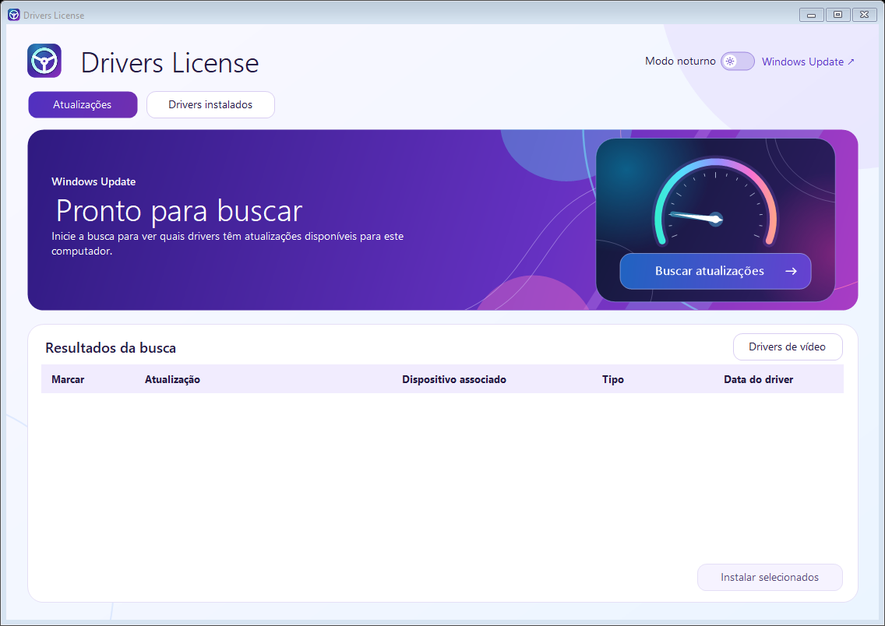
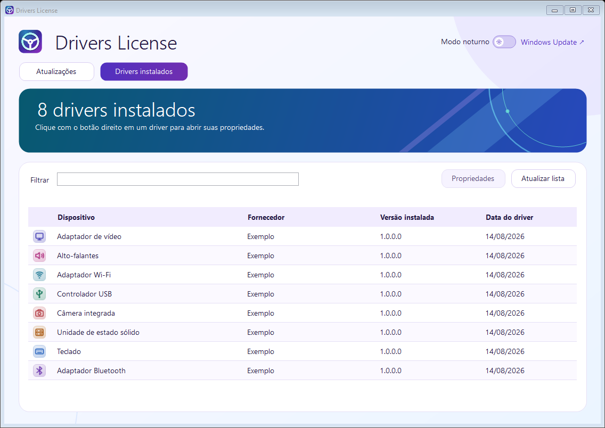

# Drivers License

Aplicativo para Windows 10 e 11, disponível com instalador ou em versão portátil. O Drivers License lê os drivers do computador em que roda e consulta o Windows Update para oferecer atualizações compatíveis, inclusive opcionais.

[Baixar o instalador ou o ZIP portátil para Windows](https://github.com/jxaoz/atualizador-de-drivers/releases/latest)

## Como usar

1. Execute o arquivo que termina em `-Setup.exe` ou extraia o ZIP portátil e abra `DriversLicense.exe`. O aplicativo usa o .NET Framework 4.8 ou superior.
2. Clique no velocímetro **Buscar atualizações**. O ponteiro se move enquanto o Windows Update responde.
3. Marque os pacotes desejados e clique em **Instalar selecionados**. O Windows solicita permissão de administrador. Ao final, confira o resultado de cada atualização e reinicie se o Windows solicitar.
4. Em **Drivers instalados**, identifique as categorias pelos ícones. Clique com o botão direito em um driver e escolha **Propriedades**. Para ver o painel nativo do dispositivo, clique em **Abrir no Windows**.
5. Em **Drivers de vídeo**, veja a versão instalada e busque atualizações de vídeo pelo Windows Update. Para placas NVIDIA, AMD e Intel, **Downloads oficiais** abre a página do fabricante.

Quando uma busca completa termina sem ofertas, a área de resultados exibe **Todos os drivers estão em dia!**. O interruptor **Modo noturno**, no topo, salva o tema escolhido para a próxima abertura.

O inventário é lido localmente. Para busca e instalação, o Windows se comunica com a fonte de atualizações definida para aquele computador. As ofertas disponíveis variam conforme o hardware, a versão do Windows e as políticas locais.

O instalador e o aplicativo estão sem assinatura digital. O Windows pode exibir um aviso ou bloquear a abertura de acordo com a configuração do computador. [Microsoft SmartScreen](https://learn.microsoft.com/windows/apps/package-and-deploy/smartscreen-reputation)

## Compilar

Execute `Build.ps1` com o Windows PowerShell em um computador com .NET Framework 4.8. O script gera `DriversLicense.exe` na mesma pasta. Use `-OutputPath` para escolher outro destino.

Para gerar o instalador, execute `BuildInstaller.ps1` após compilar o aplicativo. Use `-CompilerPath` para informar onde está o `ISCC.exe` do Inno Setup 6.6 ou superior, caso o script não o encontre. [Inno Setup](https://jrsoftware.org/inno-setup/downloads)
